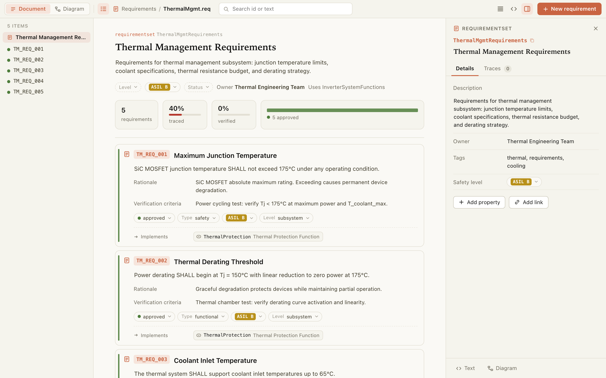
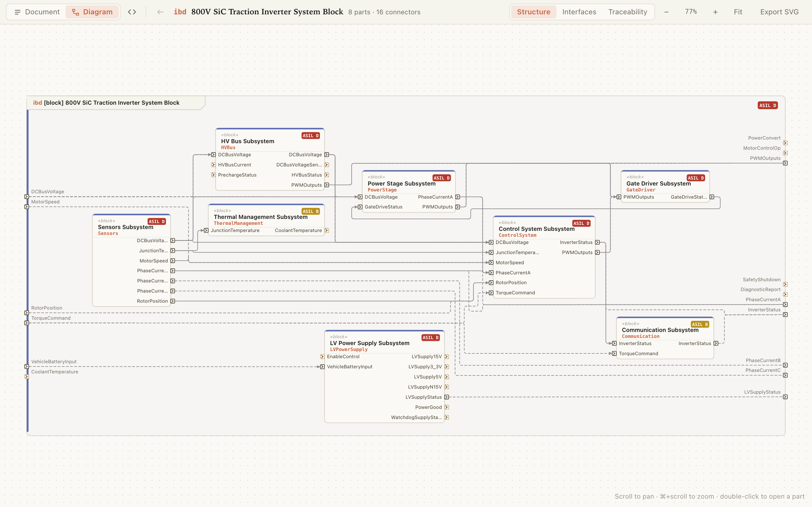
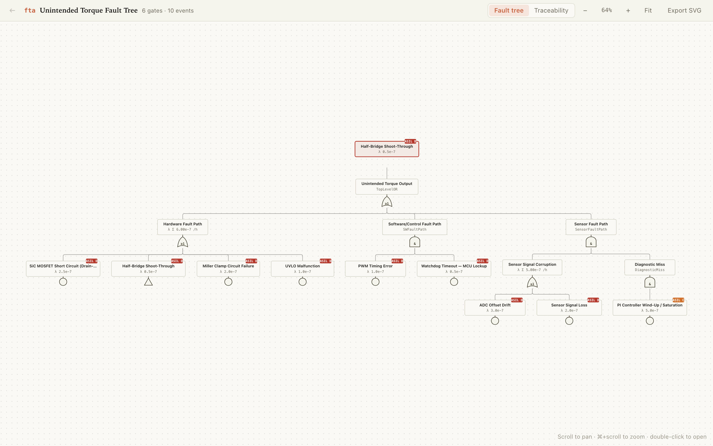
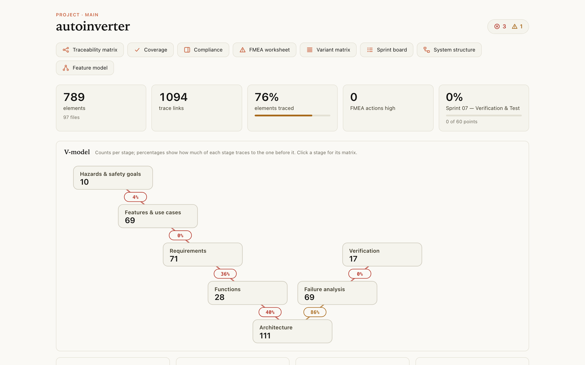
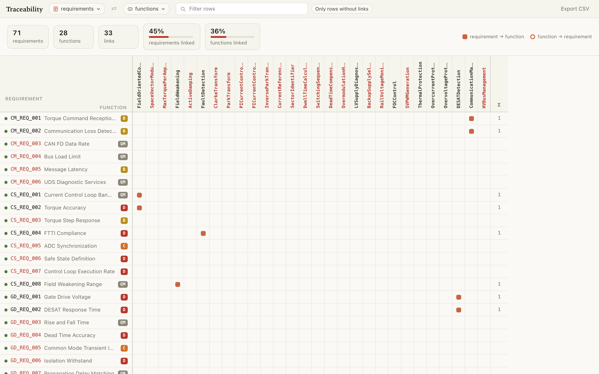
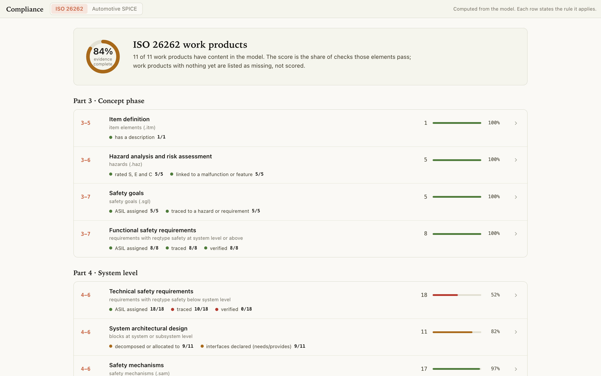
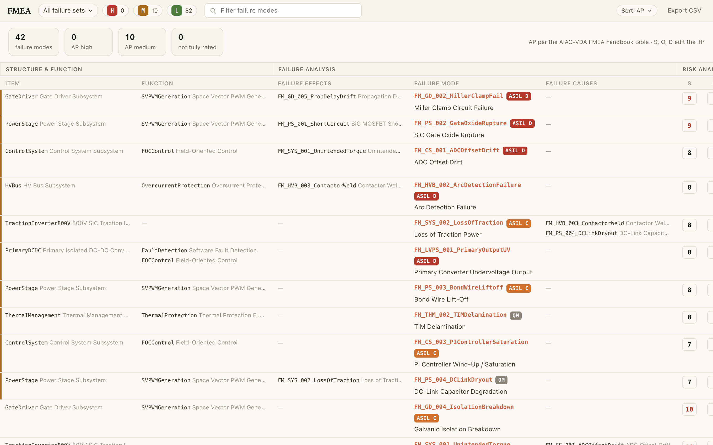
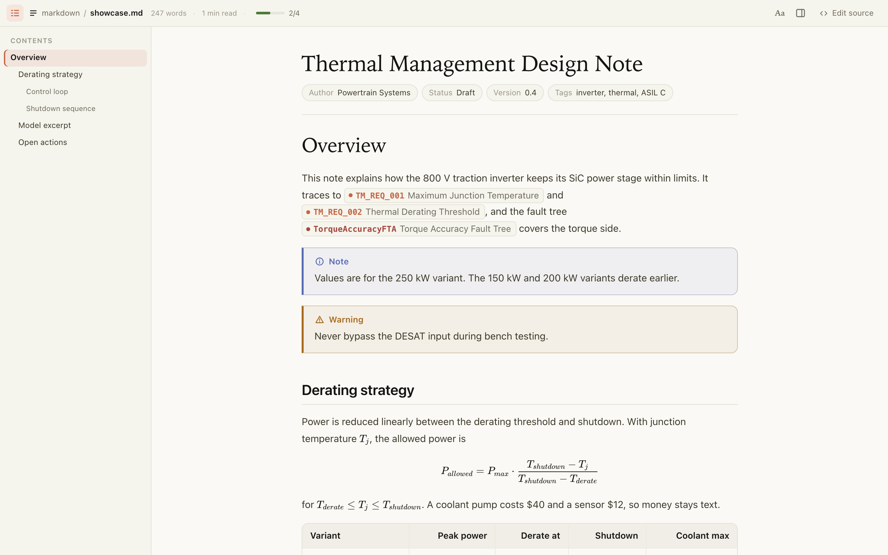

# Sylang

**A text language for systems engineering.** Requirements, architecture, interfaces, safety analyses, variants and tests live in plain text files, with traceability between them. The files diff, branch and merge in git, and AI assistants can read and write them.

[](https://marketplace.visualstudio.com/items?itemName=balaji-embedcentrum.sylang)
[](LICENSE)



This repository holds the **language reference**: one help file per file type, the complete reference, the relations matrix, a project guide, and prompts for AI assistants. The **Sylang extension for Visual Studio Code** reads the same files, validates them as you type, and shows them in Sylang Studio: editable documents, diagrams, a traceability matrix, coverage, ISO 26262 and Automotive SPICE compliance, an AIAG-VDA FMEA worksheet and a variant matrix.

> Sylang will be fully open-sourced in Q1 2027. The language reference in this repository is published under the Apache License 2.0 now, and the extension is free to use.

## Install the VS Code extension

1. Open Visual Studio Code (1.101 or later).
2. Open the Extensions view: `Ctrl+Shift+X` (Windows, Linux) or `Cmd+Shift+X` (macOS).
3. Search for **Sylang**, published by *balaji-embedcentrum*, and choose **Install**.

From a terminal: `code --install-extension balaji-embedcentrum.sylang`.

To install a downloaded `.vsix` file instead, open the Extensions view, choose **…** at the top, then **Install from VSIX…**. This also works in VS Code-based editors that do not use the Visual Studio Marketplace.

## Start a model

1. Open a project folder in VS Code and create a file named `Thermal.req`:

   ```sylang
   hdef requirementset ThermalRequirements
     name "Thermal Management Requirements"
     owner "Thermal Engineering Team"

     def requirement TM_REQ_001
       name "Maximum Junction Temperature"
       description "SiC MOSFET junction temperature SHALL NOT exceed 175 °C under any operating condition."
       reqtype safety
       safetylevel ASIL-B
       status draft
   ```

2. The file opens in **Sylang Studio**. Edit text in place, choose values from menus, and add links to elements in other files. Every change is written back to the text as the smallest possible edit. `<>` in the title bar opens the plain text beside it.
3. Files that describe structure (blocks, functions, interfaces, use cases, sequences, state machines, features, variants, fault trees and failure analyses) open on their **diagram**. The **Document | Diagram** switch at the top left changes the view.
4. Run **Sylang: Home** from the Command Palette (`Ctrl+Shift+P` or `Cmd+Shift+P`) to see the whole project: coverage across the V-model, problems, and the other views.
5. Run **Sylang: Create Sylang Help** to copy this reference into your project as a `sylang-help` folder. It opens in a Markdown reading view, and AI assistants working in the project can read it too.

Problems appear in the Problems panel and on Studio cards as you type: unknown keywords, invalid values, missing `use` imports, references to elements that do not exist, and relations that point at the wrong kind of element.

## Which files to create

The [Project Guide](language/sylang-help/project-guide-help.md) says which file types to use for IT and software, automotive, aerospace, medical and industrial projects, how to lay out the folders, and in what order to build the model. Start there, or point your AI assistant at it.

| Extension | Contains |
|---|---|
| `.ple` | Product line |
| `.fml` | Feature model |
| `.vml` | Variant model: a selection of features |
| `.vcf` | Variant configuration, generated from a `.vml` |
| `.req` | Requirements |
| `.fun` | Functions |
| `.blk` | Blocks, their interfaces and product characteristics |
| `.ifc` | Interfaces: operations, signals, data types, parameters |
| `.ucd` | Use cases |
| `.seq` | Sequences |
| `.smd` | State machines |
| `.tst` | Test cases |
| `.itm` | Item definition (ISO 26262) |
| `.haz` | Hazard analysis and risk assessment (ISO 26262) |
| `.sgl` | Safety goals (ISO 26262) |
| `.sam` | Safety mechanisms (ISO 26262) |
| `.flr` | Failure modes, effects and causes (FMEA) |
| `.fta` | Fault trees |
| `.spr` | Sprints, epics, stories and tasks |
| `.agt` | Agents and team members |
| `.spec` | Specifications assembled from the model |
| `.dash` | Dashboards of metrics, charts and tables |
| `.sylangextend` | Your own properties and enum values |

## The language in brief

```sylang
use functionset ThermalFunctions

hdef requirementset ThermalRequirements
  name "Thermal Management Requirements"

  def requirement TM_REQ_002
    name "Thermal Derating"
    description """
      The inverter SHALL reduce output torque linearly between
      150 °C and 175 °C junction temperature.
      """
    status approved          # comments start with # or //
    reqtype functional
    implements ref function ThermalDerating
```

- **One header per file.** `hdef` names the file's container; every `def` is indented under it, two spaces per level.
- **Relations always say what they point at:** `implements ref function ThermalDerating`, `derivedfrom ref safetygoal SG_01`.
- **`use` imports another file's header** before you refer to its elements: `use functionset ThermalFunctions`.
- **Text** goes in `"double quotes"` on one line, or `"""triple quotes"""` across several lines. Values such as `approved` or `ASIL-B` are bare words.
- **Comments** start with `#` or `//`, on their own line or after a value.

Each file type's help lists exactly which keywords and values it accepts; those lists are generated from the language, so they match the validator.

## See it in Studio















## With AI assistants

- **Project Guide and help files.** Ask the assistant to read [`project-guide-help.md`](language/sylang-help/project-guide-help.md) and the help for the file types it writes. Every example in the help passes the validator.
- **MCP server.** The extension registers a Model Context Protocol server with VS Code, so Copilot agent mode and other MCP clients can query the model: summaries, search, traceability, impact, model health, and the exact syntax of each file type. **Sylang: Copy MCP Server Configuration** gives the entry for other tools.
- **`@sylang` in chat.** For example `/trace TM_REQ_001`, `/health` or `/schema req`.
- **Prompts.** [`sylang-prompts/`](language/sylang-help/sylang-prompts/) has one prompt per file type.

## Reference

| Document | What it covers |
|---|---|
| [Help index](language/sylang-help/README.md) | All help files, by topic |
| [Project Guide](language/sylang-help/project-guide-help.md) | Files, folders and build order per domain |
| [Complete reference](language/sylang-help/SYLANG_COMPLETE_REFERENCE.md) | Every file type in one document |
| [Relations matrix](language/sylang-help/relations-matrix-help.md) | Every relation, and the kinds of element it connects |
| [Extending the language](language/sylang-help/extend-help.md) | Your own properties and enum values with `.sylangextend` |

## Feedback

Report problems and ideas in [Issues](https://github.com/balaji-embedcentrum/sylang/issues). More at [sylang.dev](https://sylang.dev).

## License

The language reference in this repository is licensed under the [Apache License 2.0](LICENSE). Copyright © 2025 Balaji Boominathan.
